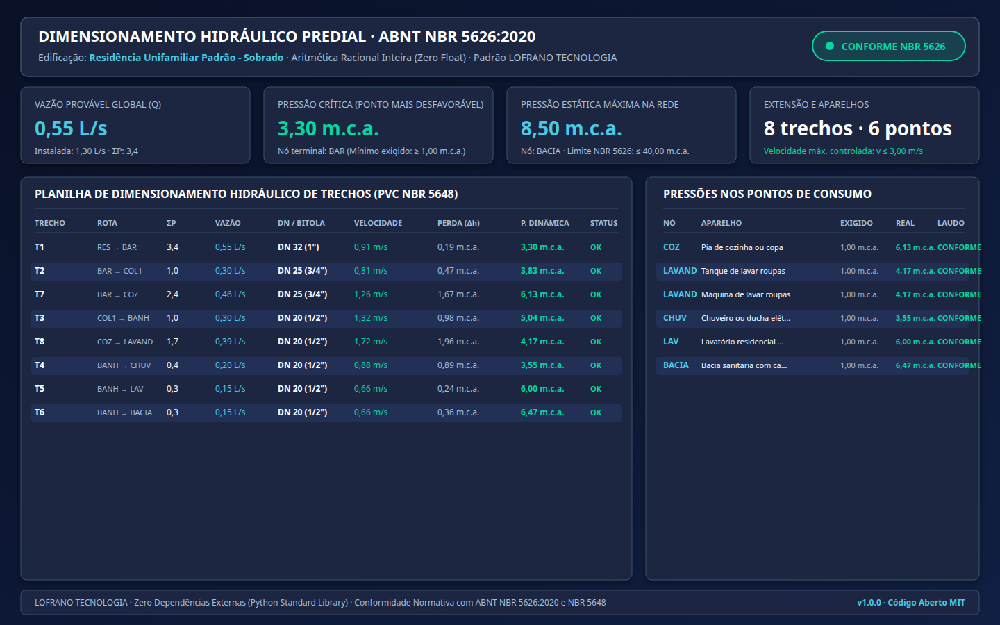

# dimensionamento-hidraulica-predial-nbr5626

[](https://github.com/martinlofranodeoliveira/dimensionamento-hidraulica-predial-nbr5626/actions/workflows/ci.yml)
[](https://www.python.org/)
[](LICENSE)
[-brightgreen.svg)]()
[]()
[]()

Motor determinístico de dimensionamento, cálculo e auditoria de instalações prediais de água fria e quente segundo a norma técnica brasileira **ABNT NBR 5626:2020** e especificações de tubulações de PVC rígido soldável **ABNT NBR 5648**.

Desenvolvido sob o padrão industrial de engenharia da **LOFRANO TECNOLOGIA**: **zero dependências externas** (opera exclusivamente sobre a biblioteca padrão do Python 3.11+), **zero ponto flutuante** (banimento completo de `float`, operando com números inteiros em milímetros, mililitros por segundo, milímetros de coluna d'água e frações racionais `Fraction`), codecs canônicos estritos e exportação completa em JSON canônico, planilhas CSV higienizadas contra injeção de fórmulas, Memorial de Cálculo formal em Markdown e infográfico vetorial executivo em SVG de 1440×900 pixels.

---

## Painel Executivo de Dimensionamento Hidráulico



---

## Fundamentação Normativa e Engenharia de Cálculo

1. **Método Probabilístico dos Pesos Relativos (NBR 5626)**:
   A vazão provável de dimensionamento para trechos que atendem múltiplos aparelhos de uso simultâneo intermitente é dada por:
   $$Q = 0,30 \times \sqrt{\sum P} \quad (\text{L/s})$$
   Na formulação inteira exata da biblioteca, a soma dos pesos é representada em décimos de peso ($S_{dec} = 10 \times \sum P$), calculando a raiz quadrada exata via inteiros sem desvios binários:
   $$Q_{\text{mL/s}} = \left( 30 \times \text{isqrt}(S_{dec} \times 10 \times 1\,000\,000) + 500 \right) // 1000$$
   Para sub-ramais de alimentação exclusiva de um aparelho, adota-se a vazão nominal de projeto daquele ponto ($q_{\text{aparelho}}$).

2. **Aparelhos Sanitários Normativos (Tabela B.1 NBR 5626)**:
   - **Bacia sanitária com caixa acoplada**: $P = 0,3$ | $q = 0,15$ L/s (150 mL/s) | $P_{\min} \ge 1,0$ m.c.a.
   - **Bacia sanitária com válvula de descarga**: $P = 32,0$ | $q = 1,70$ L/s (1700 mL/s) | $P_{\min} \ge 1,5$ m.c.a.
   - **Chuveiro / Ducha elétrica**: $P = 0,4$ | $q = 0,20$ L/s (200 mL/s) | $P_{\min} \ge 1,0$ m.c.a.
   - **Lavatório**: $P = 0,3$ | $q = 0,15$ L/s (150 mL/s) | $P_{\min} \ge 1,0$ m.c.a.
   - **Pia de cozinha**: $P = 0,7$ | $q = 0,25$ L/s (250 mL/s) | $P_{\min} \ge 1,0$ m.c.a.
   - **Máquina de lavar roupas / louças**: $P = 1,0$ | $q = 0,30$ L/s (300 mL/s) | $P_{\min} \ge 1,0$ m.c.a.
   - **Tanque de lavar roupas**: $P = 0,7$ | $q = 0,25$ L/s (250 mL/s) | $P_{\min} \ge 1,0$ m.c.a.

3. **Critério de Velocidade Máxima de Escoamento ($v \le 3,0$ m/s)**:
   A velocidade média em qualquer trecho da tubulação é computada via:
   $$v = \frac{4 \times Q}{\pi \times D^2}$$
   Utilizando a aproximação racional clássica $\pi \approx 355 / 113$, a velocidade em mm/s é obtida por aritmética inteira exata:
   $$v_{\text{mm/s}} = \left( Q_{\text{mL/s}} \times 45\,200\,000 + \frac{355 \times D_{dec}^2}{2} \right) // (355 \times D_{dec}^2)$$
   O motor seleciona automaticamente o menor diâmetro nominal comercial de PVC rígido (DN 20 a DN 110) que mantém a velocidade abaixo do teto de projeto ($v \le 3,00$ m/s, ou $2,00$ m/s para requisitos acústicos).

4. **Perda de Carga em Conexões e Tubulações**:
   - **Comprimentos Equivalentes ($L_{eq}$)**: Joelhos 90º/45º, curvas, tês de passagem direta/lateral e registros de gaveta/pressão têm seus comprimentos virtuais normativos adicionados ao comprimento real:
     $$L_{\text{total}} = L_{\text{real}} + \sum L_{eq}$$
   - **Perda de Carga Total ($\Delta h$)**: Calculada com base na perda de carga unitária $J$ (mm.c.a./m) interpolada de forma racional exata em `Fraction`:
     $$\Delta h = \left\lceil \frac{J \times L_{\text{total}}}{1000} \right\rceil \quad (\text{mm.c.a.})$$

5. **Critérios de Pressão Hidráulica Estática e Dinâmica**:
   - **Pressão Dinâmica Residual Mínima**: Garante no mínimo $1,0$ m.c.a. (10 kPa) em pontos comuns e $1,5$ m.c.a. (15 kPa) em válvulas de descarga no instante de maior vazão simultânea.
   - **Pressão Estática Máxima**: Limite regulamentar absoluto de $40,0$ m.c.a. (400 kPa) para prevenir fadiga mecânica, rompimentos de juntas e ruídos de golpe de aríete.

---

## Instalação

O pacote não requer nenhuma biblioteca de terceiros. A instalação pode ser realizada via `pip`:

```bash
pip install .
```

Ou através do arquivo wheel gerado na release:

```bash
pip install dimensionamento_hidraulica_predial_nbr5626-1.0.0-py3-none-any.whl
```

---

## Estrutura do Arquivo de Entrada (JSON)

Exemplo de especificação canônica da rede:

```json
{
  "nome_edificacao": "Residência Unifamiliar Padrão - Sobrado",
  "descricao": "Instalação predial de água fria atendendo banheiro social, cozinha e lavanderia.",
  "pressao_disponivel_inicial_mmca": 2000,
  "no_origem_principal": "RES",
  "criterio_velocidade_maxima_mms": 3000,
  "criterio_pressao_estatica_max_mmca": 40000,
  "criterio_pressao_dinamica_min_mmca": 1000,
  "trechos": [
    {
      "id_trecho": "T1",
      "no_origem": "RES",
      "no_destino": "BAR",
      "comprimento_real_mm": 2000,
      "desnivel_geometrico_mm": 1500,
      "dn_fixado": 32,
      "conexoes": [
        {"tipo": "SAIDA_CANALIZACAO", "quantidade": 1},
        {"tipo": "REGISTRO_GAVETA_ABERTO", "quantidade": 1}
      ],
      "aparelhos_diretos": []
    },
    {
      "id_trecho": "T4",
      "no_origem": "BANH",
      "no_destino": "CHUV",
      "comprimento_real_mm": 1200,
      "desnivel_geometrico_mm": -600,
      "conexoes": [
        {"tipo": "TE_PASSAGEM_DIRETA", "quantidade": 1},
        {"tipo": "JOELHO_90", "quantidade": 2},
        {"tipo": "REGISTRO_PRESSAO_ABERTO", "quantidade": 1}
      ],
      "aparelhos_diretos": [
        {"codigo_aparelho": "CHUVEIRO_ELETRICO", "descricao": "Chuveiro do banheiro social", "quantidade": 1}
      ]
    }
  ]
}
```

---

## Uso da Linha de Comando (CLI)

O executável `hidraulica-nbr5626` fornece comandos para dimensionamento e emissão de modelos:

### 1. Dimensionar Rede e Exibir Relatório

```bash
hidraulica-nbr5626 dimensionar projeto.json
```

Saída no terminal:
```text
Edificação: 'Residência Unifamiliar Padrão - Sobrado' · Status NBR 5626: [APROVADO]
Total de Trechos: 8 · Total de Aparelhos: 6
Vazão Provável Global: 0,55 L/s (Instalada: 1,30 L/s · ΣP: 3,4)
Ponto Crítico Mais Desfavorável: Nó 'CHUV' com 3,55 m.c.a.
Pressão Estática Máxima: Nó 'BACIA' com 7,50 m.c.a. (Limite: ≤ 40,00 m.c.a.)

--- TRECHOS DIMENSIONADOS ---
  [T1   ] RES → BAR    | ΣP:  3,4 | Q: 0,55 L/s | DN  32 (1"   ) | v: 0,91 m/s [OK] | P.Dinâmica: 3,19 m.c.a.
  [T2   ] BAR → COL1   | ΣP:  1,0 | Q: 0,30 L/s | DN  25 (3/4" ) | v: 0,81 m/s [OK] | P.Dinâmica: 3,74 m.c.a.
  [T3   ] COL1 → BANH  | ΣP:  1,0 | Q: 0,30 L/s | DN  20 (1/2" ) | v: 1,32 m/s [OK] | P.Dinâmica: 4,77 m.c.a.
  [T4   ] BANH → CHUV  | ΣP:  0,4 | Q: 0,20 L/s | DN  20 (1/2" ) | v: 0,88 m/s [OK] | P.Dinâmica: 3,55 m.c.a.
...

--- VERIFICAÇÃO NOS PONTOS DE CONSUMO ---
  [Nó CHUV  ] Chuveiro ou ducha elétrica          | Exigido: 1,00 m.c.a. | Real: 3,55 m.c.a. | CONFORME
  [Nó LAV   ] Lavatório residencial ou comercial  | Exigido: 1,00 m.c.a. | Real: 6,00 m.c.a. | CONFORME
  [Nó BACIA ] Bacia sanitária com caixa acoplada  | Exigido: 1,00 m.c.a. | Real: 6,47 m.c.a. | CONFORME
  [Nó COZ   ] Pia de cozinha ou copa              | Exigido: 1,00 m.c.a. | Real: 6,13 m.c.a. | CONFORME
  [Nó LAVAND] Tanque de lavar roupas              | Exigido: 1,00 m.c.a. | Real: 4,17 m.c.a. | CONFORME
```

### 2. Exportar Dossiê Técnico Completo e ZIP

```bash
hidraulica-nbr5626 dimensionar projeto.json --saida relatorios/ --zip dossie-hidraulico.zip
```

Arquivos gerados:
- `resultado_hidraulico.json`: Estrutura canônica completa com memória de cálculo.
- `trechos_dimensionados.csv`: Planilha detalhada de trechos, perdas e pressões (sanitizada contra injeção de fórmulas).
- `pontos_consumo.csv`: Verificação pontual nos aparelhos sanitários.
- `memorial_calculo.md`: Memorial descritivo de engenharia formatado em Markdown.
- `painel_hidraulico.svg`: Infográfico vetorial independente (1440×900).
- `dossie-hidraulico.zip`: Pacote consolidado com timestamps congelados e hash verificável.

### 3. Consultar Tabelas Normativas da NBR 5626

```bash
hidraulica-nbr5626 tabelas
```

---

## Verificação e Auditoria Independente

### 1. Testes Automatizados

Execute os 56 testes unitários:

```bash
python3 -m unittest discover -s tests -v
```

### 2. Auditoria Independente em SQLite

Para garantir total imparcialidade e conformidade dos algoritmos, um verificador independente implementado sobre banco de dados relacional em memória `sqlite3` recalcula as variáveis hidráulicas sem importar o código de produção:

```bash
python3 tools/verify_independent.py exemplares/instalacao_predial_padrao.json
```

Saída:
```text
[*] Iniciando auditoria independente SQLite de: exemplares/instalacao_predial_padrao.json
[*] Auditoria Estrutural:
    - Total de Trechos Cadastrados: 8
    - Total de Aparelhos Sanitários: 6
    - Soma Total de Pesos Relativos: 3,4
    - Vazão Provável Global Independente: 553 mL/s (0.553 L/s)
      • Teste DN 20 (d_int=17.0 mm): vel = 2436 mm/s (2.44 m/s)
        -> Primeiro DN comercial que atende v <= 3,0 m/s: DN 20
[OK] Auditoria independente de dimensionamento hidráulico NBR 5626 aprovada com 100% de conformidade!
```

---

## Licença

Distribuído sob a licença [MIT](LICENSE). Consulte o arquivo `LICENSE` para mais detalhes.

Copyright (c) 2026 LOFRANO TECNOLOGIA.
